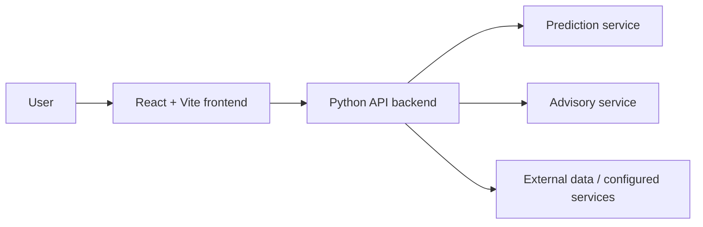

# CropShield AI 🌱

**CropShield AI** is an agricultural management web application concept that brings crop-related insights, weather information, field mapping, and advisory features into one interface. This repository contains a React/Vite frontend and a Python backend with FastAPI and ML/advisory service modules.

> **Project status:** This repository includes a mix of application UI, API code, and prototype/demo behavior. Some endpoints in `backend/server_stdlib.py` return hard-coded sample data or mock authentication responses. Treat those responses as demonstration data, not live farm telemetry or verified agronomic recommendations.

## Features

- **Dashboard:** Crop-related overview and insight-oriented UI.
- **Weather view:** Weather and spray-planning interface; confirm the data source and live API integration in the implementation before relying on it.
- **Field map:** Interactive map interface built with Leaflet / React Leaflet dependencies.
- **AI advisory:** Backend advisory service module for crop-related questions.
- **Prediction endpoint:** Backend ML prediction service module using an XGBoost-oriented predictor.
- **History and profile UI:** Interfaces for organizing user and activity information.

Feature availability can depend on the selected backend and configuration. The standalone server contains sample weather, sensor, and history payloads.

## Architecture



High-level architecture based on the repository structure. Exact behavior depends on which backend entry point is run and which integrations are configured.

## Technology Stack

### Frontend

- React 19 and Vite
- Tailwind CSS
- Framer Motion
- Leaflet and React Leaflet
- Chart.js and React Chart.js
- Axios
- Lucide React icons

### Backend

- Python and FastAPI
- Uvicorn
- XGBoost, scikit-learn, pandas, and NumPy dependencies
- Pydantic
- Separate advisory service module

## Repository Structure

```text
cropshield-ai/
├── frontend/
│   ├── src/
│   │   ├── components/
│   │   ├── context/
│   │   ├── pages/
│   │   ├── services/
│   │   └── App.jsx
│   ├── package.json
│   └── vite.config.js
└── backend/
    ├── app/
    │   ├── routers/
    │   ├── services/
    │   └── main.py
    ├── requirements.txt
    ├── run.py
    └── server_stdlib.py
```

## Prerequisites

- Node.js and npm
- Python 3.10 or newer recommended
- Git

## Run Locally

### 1. Clone the repository

```bash
git clone https://github.com/Rohith00755/cropshield-ai.git
cd cropshield-ai
```

### 2. Start the frontend

```bash
cd frontend
npm install
npm run dev
```

Use the local URL printed by Vite in the terminal. The exact port may vary if the default port is already in use.

### 3. Start the FastAPI backend

Open a second terminal from the repository root:

```bash
cd backend
python -m venv .venv
```

Activate the environment:

```bash
# Windows PowerShell
.venv\Scripts\Activate.ps1
```

```bash
# macOS / Linux
source .venv/bin/activate
```

Install dependencies and start the API:

```bash
pip install -r requirements.txt
python run.py
```

The `run.py` entry point starts Uvicorn on port 8000. If startup fails, check the Python version, installed dependencies, and imports before assuming the backend is running.

Once the backend starts, inspect the interactive API documentation at [http://localhost:8000/docs](http://localhost:8000/docs).

## Configuration and Secrets

- Review the frontend service modules and backend settings to identify the environment variables required by the current implementation.
- Keep API keys, private credentials, and production tokens out of source control.
- If a `.env` file is needed, create it locally and ensure it is ignored by Git.
- Never treat frontend environment variables as secret; values bundled into a browser application can be exposed to users.

## Demo Data and Limitations

- `backend/server_stdlib.py` includes hard-coded sample weather, sensor telemetry, and history responses.
- The standalone server's login/register handlers return mock tokens; they are not production authentication.
- A displayed sensor status does not prove that a physical sensor or ESP32 is connected.
- ML predictions and AI advisory output should be evaluated against suitable datasets and expert-reviewed guidance before practical use.
- No claim of model accuracy, field-trial performance, or production readiness is made in this README.

## Suggested Improvements

1. Clearly separate mock/demo endpoints from production API routes.
2. Document required environment variables and integrations from the actual code.
3. Add tests for API routes, prediction input validation, and error handling.
4. Add screenshots of the current application and a short demo workflow.
5. Record model provenance, training data, evaluation metrics, and limitations before making accuracy claims.
6. Document the actual authentication and data persistence implementation once verified.

## Contributing

Suggestions and bug reports are welcome through GitHub Issues. When reporting a problem, include the steps to reproduce it and relevant console or server logs, but remove credentials and personal data.

## License

The previous README identified this project as MIT licensed. Ensure a matching `LICENSE` file exists in the repository root before distributing the project under that license.

## Author

**Rohith S** · [GitHub](https://github.com/Rohith00755) · [LinkedIn](https://www.linkedin.com/in/rohith-sathish-971052327)
